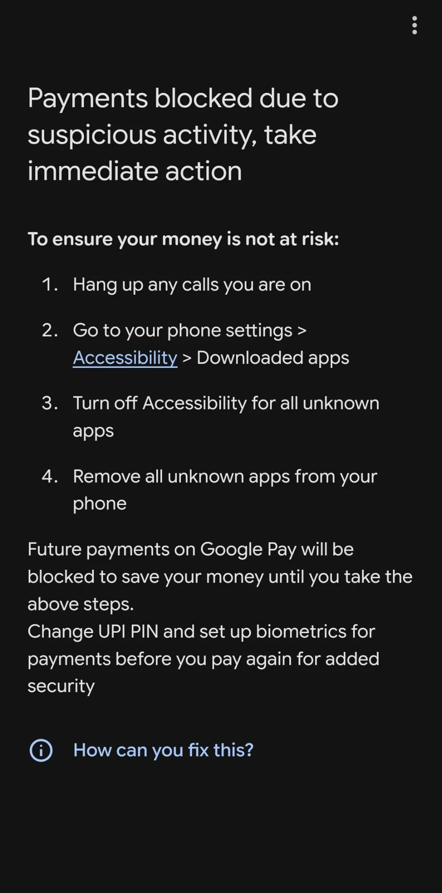
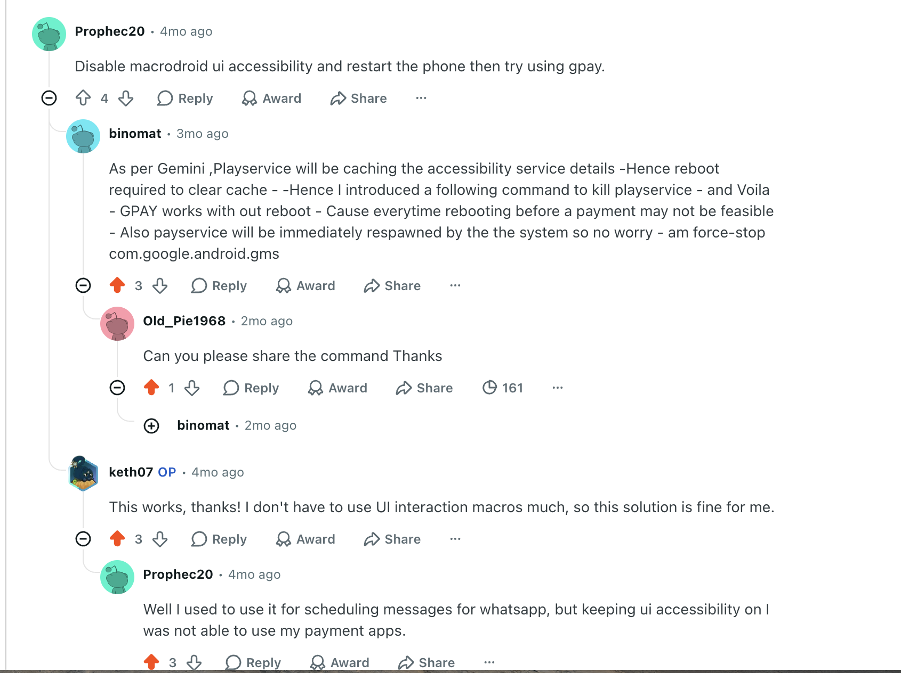

# GPay Ready

A tiny, no-root Android utility that fixes **banking / payment apps refusing to work when a legitimate
accessibility app is enabled** (MacroDroid, custom launchers, side-bar/gesture apps, etc.).

Google Pay and many banking apps flag any accessibility service that *looks like* an automation tool —
and also **Developer Options / USB debugging** — and then block the action (e.g. Google Pay's
**"Something went wrong and your payment can't be completed"** / **"Close screen sharing app"**), even
though those apps are legitimate and you installed them on purpose. The reliable fix is to turn
accessibility (and Developer Options / USB debugging) **off while you use the app** and back **on
afterwards** — exactly the state these apps want. This app does that in one tap, no root, no Shizuku.

## The problem this fixes

Recent Google Pay (India) builds show this when a legitimate accessibility app (MacroDroid, a custom
launcher, a gesture app) is enabled — and block payments until you turn accessibility off:

<p align="center">
  
</p>

The apps it flags are ones you installed on purpose. GPay Ready turns accessibility off just while you
pay (and back on after) — exactly the state this check wants — so the payment goes through.

**Works with any apps you pick — select one or more.** Choose any banking/finance apps (or any apps) as
targets; the manual fix and the automation both use your selection. Any/all banking apps can be added.
Google Pay is just the default.

> Tested on a **Pixel 11, Android 17 (QPR3 Beta 3)** — works perfectly there. **Not yet tried on other
> phones / Android versions.** It uses standard Android settings, so it should work on other devices,
> but please report back.

> **How this was built — full transparency:** this is a "vibe-coded" app. I built it with
> [Claude Code](https://www.anthropic.com/claude-code) and I don't know the nitty-gritties of the code
> myself. It uses standard, documented Android APIs (no root, no Shizuku), but **please read the source
> and the permissions before you trust it** — especially since it requests `WRITE_SECURE_SETTINGS`.
> Review, issues, and PRs from people who do know the internals are very welcome.

## ⚠️ Required one-time setup (needs a computer with adb, once)

This app **cannot do anything until you grant it one permission over adb**. There is **no on-device way**
to grant `WRITE_SECURE_SETTINGS` — you must connect the phone to a computer **once** and run:

```
adb shell pm grant dev.gpayready android.permission.WRITE_SECURE_SETTINGS
```

- **No root, no Shizuku.** It's a one-time command; you never need the computer again afterwards.
- It's the same documented grant the "Dev Options toggler" apps use. Revoke any time with `pm revoke`.
- Everything else (Usage Access for the automation, the Quick Settings tile) is granted **on-device**, no computer.

Without this grant the accessibility toggle silently does nothing.

## What it does

First, **pick your target apps** in the app (default Google Pay — select one or more banking/finance apps,
or any apps). Then one tap (button, Quick Settings tile, home-screen icon, or from
MacroDroid/Tasker/launcher) runs:

1. **Turn accessibility OFF** — saves your currently-enabled accessibility services, then clears them.
2. **Turn Developer Options + USB/Wireless debugging OFF** — remembering what was on, to put back later.
3. **Stop the target app** and **Stop Play Services** — kills their cached background processes so they
   re-check cleanly on next open.
4. **Open the target app** — ready to use.

Afterwards, **Restore everything** (button / QS tile / automation) turns accessibility **and** Developer
Options / USB debugging back on — restoring only what was actually on before.

### Automation (optional, Usage Access — not accessibility)

Enable **Auto** in the app and it watches the foreground app via **Usage Access**: when any chosen app comes to the front it turns accessibility (and Developer Options / debugging) **off**, and **restores
them the moment you leave the app** (with a short debounce so a mid-payment OTP/bank-redirect dip doesn't
restore early). So your automation apps are only off for the few seconds you're actually using it. This
works for **any app you select**, not just Google Pay.

## How it works (no root, no Shizuku, no debugging left on)

| Step | Mechanism | Permission |
|------|-----------|------------|
| Accessibility off/on | writes `enabled_accessibility_services` (saved & restored) | `WRITE_SECURE_SETTINGS` — granted **once over adb** |
| Dev Options / USB debugging off/on | writes `development_settings_enabled` / `adb_enabled` / `adb_wifi_enabled` (saved & restored) | `WRITE_SECURE_SETTINGS` |
| Stop target app / Play Services | `ActivityManager.killBackgroundProcesses()` | `KILL_BACKGROUND_PROCESSES` (normal, auto-granted) |
| Auto on open/close | `UsageStatsManager` foreground-app events | Usage Access (granted in Settings) |

No Shizuku, no root, and no wireless/USB debugging is *left on* — the fix turns debugging off (banking
apps read that state). `killBackgroundProcesses` is **not** a full `am force-stop` (it won't stop a
running foreground service), but turning accessibility off is the actual block-clear; the kills just
nudge the cached state.

> Note: because the fix turns **USB debugging off**, running it drops any active adb/cable session — that's
> intended. **Restore everything** (or the automation on close) turns it back on if it was on before.

## Setup

1. Install the APK (`./gradlew :app:assembleDebug`, then `adb install -r app/build/outputs/apk/debug/app-debug.apk`).
2. Grant the one-time permission over adb (no root):

   ```
   adb shell pm grant dev.gpayready android.permission.WRITE_SECURE_SETTINGS
   ```

3. Open the app → **Fix & open Google Pay**. Optionally **Add Quick Settings tile** and/or turn on
   **Auto** (it will ask for Usage Access).

## Use from MacroDroid / Tasker / launchers

- **MacroDroid → Action → Launch Shortcut → GPay Ready** (uses the `CREATE_SHORTCUT` picker).
- **Broadcast:** `adb shell am broadcast -n dev.gpayready/.RunReceiver -a dev.gpayready.RUN`
  (restore with `-a dev.gpayready.RESTORE`). The headless parts always run; opening Google Pay is most
  reliable via the Launch Shortcut path.

## Honest notes

- This does **not** bypass any security. It toggles **your own** accessibility services — which you
  control — to the state Google Pay asks for, then restores them. Use it on your own device.
- If Google changes the check, this may need updating. PRs welcome.

## Review it yourself, fork it, verify it

**Don't trust — verify.** The whole app is ~480 lines of Kotlin across 8 small files, with every
security-relevant line in **one file**. Notably, there is **no `INTERNET` permission** in the manifest,
so it physically cannot send your data anywhere.

### 1. Read the code (5 minutes)
- [`app/src/main/java/dev/gpayready/GpayFix.kt`](app/src/main/java/dev/gpayready/GpayFix.kt) — **this is the
  whole thing**: what gets toggled, saved, killed, opened. Read this first.
- [`app/src/main/AndroidManifest.xml`](app/src/main/AndroidManifest.xml) — every permission it requests
  (7 total; no INTERNET).
- `GpayWatchService.kt` — the optional Usage-Access automation. The rest are tiny glue (tile, trampoline,
  MacroDroid shortcut, receivers).

### 2. Confirm what it can and can't do
```bash
# list every permission the app declares — should match the README table, with NO internet
grep -o 'android.permission.[A-Z_]*' app/src/main/AndroidManifest.xml | sort -u
```

### 3. Fork it
- On GitHub: click **Fork** (top-right of the repo), or with the GitHub CLI:
  ```bash
  gh repo fork gdr1999/gpay-india-accessibility-fix --clone
  ```
- Or clone directly:
  ```bash
  git clone https://github.com/gdr1999/gpay-india-accessibility-fix.git
  cd gpay-ready
  ```

### 4. Build it yourself (don't run someone else's APK)
Needs JDK 17+ and the Android SDK (`ANDROID_HOME` set).
```bash
./gradlew :app:assembleDebug
adb install -r app/build/outputs/apk/debug/app-debug.apk
adb shell pm grant dev.gpayready android.permission.WRITE_SECURE_SETTINGS
```

### 5. Verify a prebuilt APK matches the source (optional)
If you downloaded an APK instead of building, confirm it only declares the expected permissions:
```bash
# decode the APK and inspect its real manifest (needs apktool)
apktool d app-debug.apk -o out
grep -o 'android.permission.[A-Z_]*' out/AndroidManifest.xml | sort -u
# or decompile to Java to read the logic (needs jadx)
jadx app-debug.apk -d jadx-out && less jadx-out/sources/dev/gpayready/GpayFix.java
```

PRs, issues, and security reviews from people who know Android internals are very welcome.

## Credits

The core insight — that turning off the flagged accessibility services (and nudging Google Play
services, which caches that state) clears the block without a full reboot — came from this
r/macrodroid thread:

**[Unable to make payments through Google Pay — r/macrodroid](https://www.reddit.com/r/macrodroid/comments/1v1cao7/unable_to_make_payments_through_google_pay/)**

Thanks especially to:

- **[u/Prophec20](https://www.reddit.com/user/Prophec20/)** — disable the automation app's accessibility (and restart the phone) before using Google Pay.
- **[u/binomat](https://www.reddit.com/user/binomat/)** — Play services caches the accessibility-service details, so `am force-stop com.google.android.gms` clears it and Google Pay works **without** a reboot.

GPay Ready automates exactly this (accessibility off → stop the app + Play services → open it, then
restore), with no root and no manual steps.

<p align="center">
  
</p>

## License

MIT — see [LICENSE](LICENSE).
