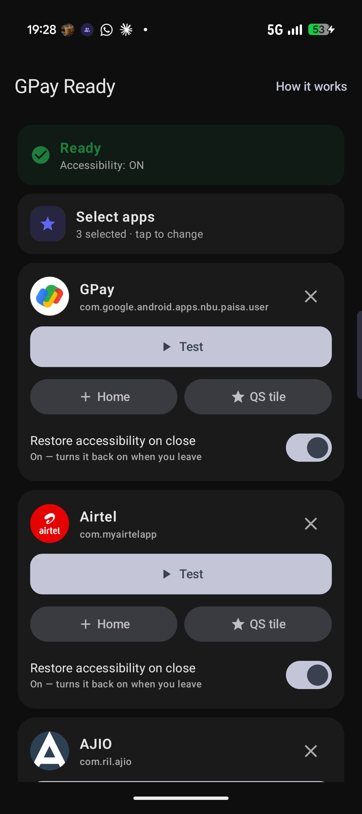
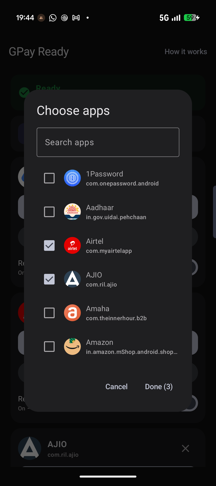
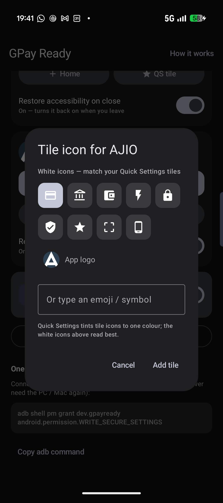

# GPay Ready

<p align="center">
  <a href="https://github.com/gdr1999/gpay-india-accessibility-fix/releases/latest/download/GPayReady.apk">
    
  </a>
</p>

<p align="center">
  <a href="https://github.com/gdr1999/gpay-india-accessibility-fix/releases/latest"></a>
  
  
</p>

<p align="center"><sub>Downloads the APK directly · then run the one-time adb setup (below)</sub></p>

A tiny, no-root Android utility that fixes **banking / payment apps refusing to work when a legitimate
accessibility app is enabled** (MacroDroid, custom launchers, side-bar/gesture apps, etc.).

> **Works with any app — not just Google Pay.** Point it at any banking / UPI / finance app
> (PhonePe, Paytm, your bank app…) or literally any app on your phone. Select one or many — the one-tap
> fix, the Home-screen icons, the Quick Settings tiles and the automation all use your selection.
> Google Pay is only the default.

<p align="center">
  
  
  
</p>

Google Pay and many banking apps flag any accessibility service that *looks like* an automation tool —
and also **Developer Options / USB debugging** — and then block the action (e.g. Google Pay's
**"Something went wrong and your payment can't be completed"** / **"Close screen sharing app"**), even
though those apps are legitimate and you installed them on purpose. The reliable fix is to turn
accessibility (and Developer Options / USB debugging) **off while you use the app** and back **on
afterwards** — exactly the state these apps want. This app does that in one tap, no root, no Shizuku.

## The problem this fixes

Recent Google Pay (India) builds show this when a legitimate accessibility app (MacroDroid, a custom
launcher, a gesture app) is enabled — and block payments until you turn accessibility off:

<p align="center">
  
</p>

The apps it flags are ones you installed on purpose. GPay Ready turns accessibility off just while you
pay (and back on after) — exactly the state this check wants — so the payment goes through.

**Works with any apps you pick — select one or more.** Choose any banking/finance apps (or any apps) as
targets; the manual fix and the automation both use your selection. Any/all banking apps can be added.
Google Pay is just the default.

> Tested on a **Pixel 11, Android 17 (QPR3 Beta 3)** — works perfectly there. **Not yet tried on other
> phones / Android versions.** It uses standard Android settings, so it should work on other devices,
> but please report back.

> **How this was built — full transparency:** this is a "vibe-coded" app. I built it with
> [Claude Code](https://www.anthropic.com/claude-code) and I don't know the nitty-gritties of the code
> myself. It uses standard, documented Android APIs (no root, no Shizuku), but **please read the source
> and the permissions before you trust it** — especially since it requests `WRITE_SECURE_SETTINGS`.
> Review, issues, and PRs from people who do know the internals are very welcome.

## ⚠️ Required one-time setup (needs a computer with adb, once)

This app **cannot do anything until you grant it one permission over adb**. There is **no on-device way**
to grant `WRITE_SECURE_SETTINGS` — you must connect the phone to a computer **once** and run:

```
adb shell pm grant dev.gpayready android.permission.WRITE_SECURE_SETTINGS
```

- **No root, no Shizuku.** It's a one-time command; you never need the computer again afterwards.
- It's the same documented grant the "Dev Options toggler" apps use. Revoke any time with `pm revoke`.
- Everything else (Usage Access for the automation, the Quick Settings tile) is granted **on-device**, no computer.

Without this grant the accessibility toggle silently does nothing.

## What it does

First, **pick your target apps** in the app (default Google Pay — select one or more banking/finance apps,
or any apps). Then one tap (button, Quick Settings tile, home-screen icon, or from
MacroDroid/Tasker/launcher) runs:

1. **Turn accessibility OFF** — saves your currently-enabled accessibility services, then clears them.
2. **Turn Developer Options + USB/Wireless debugging OFF** — remembering what was on, to put back later.
3. **Nudge Play Services / the target app** — best-effort only. **Note:** on **Android 14+** a normal
   app can only stop its *own* process, so this can't truly force-stop Play Services or Google Pay; a
   real reset needs the in-app **Deep reset** (App info → Force stop) or a **restart** (see below).
4. **Open the target app** — ready to use.

Afterwards, **Restore everything** (button / QS tile / automation) turns accessibility **and** Developer
Options / USB debugging back on — restoring only what was actually on before.

### Automation (optional, Usage Access — not accessibility)

Enable **Auto** in the app and it watches the foreground app via **Usage Access**: when any chosen app comes to the front it turns accessibility (and Developer Options / debugging) **off**, and **restores
them the moment you leave the app** (with a short debounce so a mid-payment OTP/bank-redirect dip doesn't
restore early). So your automation apps are only off for the few seconds you're actually using it. This
works for **any app you select**, not just Google Pay.

## If Google Pay still blocks you (GPay 356+)

**Confirmed on a Pixel 11 (Android 17), Nov 2026.** Google Pay India **356** turned a simple "check at
launch" into a **latch**, and it arrived as a **server-side rollout**: the 356 app was installed on 29 Oct
but the behaviour only changed days later, and non-beta users report it too — so it's a gradual flag flip
on Google's side, not something wrong with your device. What was verified on-device:

- **Accessibility is the trigger.** Accessibility **OFF + a real reboot → payments work.** Turning *any*
  automation accessibility service back on **re-flags** it (not only MacroDroid UI Interaction).
- **It's a latch that only a reboot reliably clears.** On 356, turning accessibility off *afterwards* is
  **not enough** — once flagged you stay blocked until the state is flushed, and a **real reboot** is the
  proven clear.
- **The app can't do that last step.** On **Android 14+**, `killBackgroundProcesses()` only stops the
  app's *own* process, so it **cannot** force-stop Play Services or Google Pay, and no normal app can
  reboot. So the app reliably turns accessibility off, but **clearing the latch is a manual reboot.**
- **A force-stop does NOT clear 356's latch — only a reboot does (tested).** We force-stopped *both* Play
  Services and Google Pay (a real `am force-stop`, what the in-app "Deep reset" does) with accessibility
  off and **no** reboot → **still blocked.** The latch is a **cached Play Integrity / DroidGuard
  attestation** (`tapandpay_get_last_attestation_result` in the APK); a force-stop re-reads the cached
  verdict, only a reboot forces fresh attestation.

**The reliable no-root recipe (works for everyone):**
1. **Accessibility (+ Developer Options) OFF** — the app does this (needs the one-time adb grant below).
2. **Reboot** the phone — this is the **only** confirmed way to clear the latch. (A force-stop / "Deep
   reset" does **not** work on 356.)
3. **Pay before turning accessibility back on** — turning it on re-flags you (needs another reboot).

> **Reinstalling the app? Re-grant the permission.** The `pm grant` is **per-install** — uninstalling or
> reinstalling **revokes** it, and the app then silently can't toggle anything. Re-run
> `adb shell pm grant dev.gpayready android.permission.WRITE_SECURE_SETTINGS` and confirm the app shows
> **"Ready"** (not "Needs one-time adb setup"). Debug mode shows Accessibility flipping OFF when the fix runs.

> **On the Google Pay beta?** If your Play Store page says *"You're a beta tester,"* you got 356 early —
> leaving the beta (and reverting to the stable build) may delay this until the rollout reaches stable.

> **Why it worked on 355 but not 356 — an update that closed the loophole (assumption, not confirmed).**
> Best guess from the observed behaviour: GPay **355** appears to have re-checked **live / at launch**, so
> turning accessibility **off** right before opening it was enough — the launch check saw no automation
> service and allowed the payment. (The old "stop Play Services" step was decorative: on Android 14+ it
> can't stop another app anyway.) GPay **356** seems to have **closed that loophole** by **latching** the
> verdict — once it has seen an automation-capable service, it records a blocked state that a live
> re-check no longer clears, which is why its own screen says *"restart your phone to unblock."* So on 356
> the toggle alone is no longer sufficient; you need a real flush (restart / Force stop). This is inferred
> from behaviour, **not** confirmed by Google.

### Three different Google Pay blocks — they are not the same problem

| Message | Cause | Fixable by this app? |
|---|---|---|
| *"Payments blocked due to suspicious activity"* | An accessibility app is enabled | ✅ Turn accessibility off |
| *"…Some apps have permission to make payments… Restart your phone to unblock"* | Same, but **latched** (GPay 356+) | ✅ Turn off **+ restart** to clear the latch |
| *"Your device may not be secure / doesn't meet required security standards"* | **Device-integrity** Play Integrity failure (beta OS, root, unlocked bootloader, uncertified build) | ❌ **No** — not accessibility; an OS/device-integrity issue |

> **It may be *app-access risk*, not hardware integrity.** Google's `appAccessRiskVerdict`
> (controlling / capturing / overlay apps) specifically targets automation services like **MacroDroid UI
> Interaction**, Tasker and AutoInput, and apps with **"Display over other apps."** If toggling
> everything off **+ a real restart** still blocks you, try leaving **MacroDroid UI Interaction**
> (specifically) off, and/or revoking **Display over other apps** for your automation apps, then
> restart — that's the fix reported for this exact MacroDroid setup. Check your certification at
> **Settings → Security & privacy → More security & privacy → Android OS verification** (want *Certified
> · Locked · Verified*).

### Overlays, and the free "overlay detector" trick

An app with **"Display over other apps"** *actively drawing* on screen does two things at once:
- Google Pay's **`KNOWN_OVERLAYS`** risk check flags it and can block payments — **even with accessibility
  off** (it's a *separate* trigger from the accessibility one).
- Your browser (Chrome / Brave / any) **stops showing website popups** — Android marks the window
  "obscured" (`FLAG_WINDOW_IS_OBSCURED`) when an overlay covers it.

So **your browser is a free, live overlay detector**: if website popups are broken, an overlay is active
*right now*. Turn **Display over other apps** OFF for your overlay apps — Dynamic-Island clones (e.g.
Material Capsule), sidebar launchers (e.g. Panels), floating-bubble apps — **one at a time until popups
work again**. That app is the overlay culprit.

> **Device note (Nov 2026):** on our Pixel the overlay turned out to be **Panels** — turning its overlay
> off **fixed the browser but did *not* fix Google Pay** (that block was the **accessibility** one). So
> overlays and accessibility are *independent* axes: clear overlays to rule them out and to get your
> browser popups back, but don't expect it to fix payments on its own. If the Brave/Chrome geolocation
> prompt (try `browserleaks.com/geo`) says *"Close any bubbles or overlays from other apps,"* an overlay
> is live — kill it, then tackle accessibility + reboot separately for GPay.

The app has an **"Apps that can draw over GPay"** list that jumps you straight to each app's overlay
toggle. (Android won't let one app turn another's overlay off without root — `MANAGE_APP_OPS_MODES` isn't
adb-grantable the way `WRITE_SECURE_SETTINGS` is — so you flip them yourself; the list just saves the
digging.)

### Debug mode

**Debug mode** (on by default) shows a notification + an in-app card with **Accessibility / Developer
Options / USB debugging** each OFF and a **READY / NOT-READY** verdict, so you can confirm the safe state
in the notification shade before you pay.

## How it works (no root, no Shizuku, no debugging left on)

| Step | Mechanism | Permission |
|------|-----------|------------|
| Accessibility off/on | writes `enabled_accessibility_services` (saved & restored) | `WRITE_SECURE_SETTINGS` — granted **once over adb** |
| Dev Options / USB debugging off/on | writes `development_settings_enabled` / `adb_enabled` / `adb_wifi_enabled` (saved & restored) | `WRITE_SECURE_SETTINGS` |
| Nudge target app / Play Services | `ActivityManager.killBackgroundProcesses()` — best-effort; **Android 14+: own process only** | `KILL_BACKGROUND_PROCESSES` |
| Real reset (stuck/latched block) | **App info → Force stop** (manual), or a device **restart** | — |
| Auto on open/close | `UsageStatsManager` foreground-app events | Usage Access (granted in Settings) |

No Shizuku, no root, and no wireless/USB debugging is *left on* — the fix turns debugging off (banking
apps read that state). Turning accessibility off is the actual block-clear. The "stop" step is
best-effort and, on **Android 14+**, can't truly stop another app — so a stuck/latched block needs a real
**Force stop** (App info) or a **restart**.

> Note: because the fix turns **USB debugging off**, running it drops any active adb/cable session — that's
> intended. **Restore everything** (or the automation on close) turns it back on if it was on before.

## Setup

1. Install the APK (`./gradlew :app:assembleDebug`, then `adb install -r app/build/outputs/apk/debug/app-debug.apk`).
2. Grant the one-time permission over adb (no root):

   ```
   adb shell pm grant dev.gpayready android.permission.WRITE_SECURE_SETTINGS
   ```

3. Open the app → **Fix & open Google Pay**. Optionally **Add Quick Settings tile** and/or turn on
   **Auto** (it will ask for Usage Access).

## Use from MacroDroid / Tasker / launchers

- **MacroDroid → Action → Launch Shortcut → GPay Ready** (uses the `CREATE_SHORTCUT` picker).
- **Broadcast:** `adb shell am broadcast -n dev.gpayready/.RunReceiver -a dev.gpayready.RUN`
  (restore with `-a dev.gpayready.RESTORE`). The headless parts always run; opening Google Pay is most
  reliable via the Launch Shortcut path.

## Honest notes

- This does **not** bypass any security. It toggles **your own** accessibility services — which you
  control — to the state Google Pay asks for, then restores them. Use it on your own device.
- **GPay 356+ caches the block** (the *"restart to unblock"* wording). The no-root stop can't flush that
  cache — use the in-app **Deep reset** (a real force-stop of Play Services) or restart the phone. See
  [the section above](#if-google-pay-still-blocks-you-gpay-356).
- The *"device doesn't meet required security standards"* block is a **Play Integrity** failure (beta OS,
  root, unlocked bootloader, uncertified build), **not** accessibility — this app can't fix that one.
- If Google changes the check, this may need updating. PRs welcome.

## Review it yourself, fork it, verify it

**Don't trust — verify.** The whole app is ~480 lines of Kotlin across 8 small files, with every
security-relevant line in **one file**. Notably, there is **no `INTERNET` permission** in the manifest,
so it physically cannot send your data anywhere.

### 1. Read the code (5 minutes)
- [`app/src/main/java/dev/gpayready/GpayFix.kt`](app/src/main/java/dev/gpayready/GpayFix.kt) — **this is the
  whole thing**: what gets toggled, saved, killed, opened. Read this first.
- [`app/src/main/AndroidManifest.xml`](app/src/main/AndroidManifest.xml) — every permission it requests
  (7 total; no INTERNET).
- `GpayWatchService.kt` — the optional Usage-Access automation. The rest are tiny glue (tile, trampoline,
  MacroDroid shortcut, receivers).

### 2. Confirm what it can and can't do
```bash
# list every permission the app declares — should match the README table, with NO internet
grep -o 'android.permission.[A-Z_]*' app/src/main/AndroidManifest.xml | sort -u
```

### 3. Fork it
- On GitHub: click **Fork** (top-right of the repo), or with the GitHub CLI:
  ```bash
  gh repo fork gdr1999/gpay-india-accessibility-fix --clone
  ```
- Or clone directly:
  ```bash
  git clone https://github.com/gdr1999/gpay-india-accessibility-fix.git
  cd gpay-ready
  ```

### 4. Build it yourself (don't run someone else's APK)
Needs JDK 17+ and the Android SDK (`ANDROID_HOME` set).
```bash
./gradlew :app:assembleDebug
adb install -r app/build/outputs/apk/debug/app-debug.apk
adb shell pm grant dev.gpayready android.permission.WRITE_SECURE_SETTINGS
```

### 5. Verify a prebuilt APK matches the source (optional)
If you downloaded an APK instead of building, confirm it only declares the expected permissions:
```bash
# decode the APK and inspect its real manifest (needs apktool)
apktool d app-debug.apk -o out
grep -o 'android.permission.[A-Z_]*' out/AndroidManifest.xml | sort -u
# or decompile to Java to read the logic (needs jadx)
jadx app-debug.apk -d jadx-out && less jadx-out/sources/dev/gpayready/GpayFix.java
```

PRs, issues, and security reviews from people who know Android internals are very welcome.

## Credits

The core insight — that turning off the flagged accessibility services (and nudging Google Play
services, which caches that state) clears the block without a full reboot — came from this
r/macrodroid thread:

**[Unable to make payments through Google Pay — r/macrodroid](https://www.reddit.com/r/macrodroid/comments/1v1cao7/unable_to_make_payments_through_google_pay/)**

Thanks especially to:

- **[u/Prophec20](https://www.reddit.com/user/Prophec20/)** — disable the automation app's accessibility (and restart the phone) before using Google Pay.
- **[u/binomat](https://www.reddit.com/user/binomat/)** — Play services caches the accessibility-service details, so `am force-stop com.google.android.gms` clears it and Google Pay works **without** a reboot.

GPay Ready automates exactly this (accessibility off → stop the app + Play services → open it, then
restore), with no root and no manual steps.

<p align="center">
  
</p>

## License

MIT — see [LICENSE](LICENSE).
